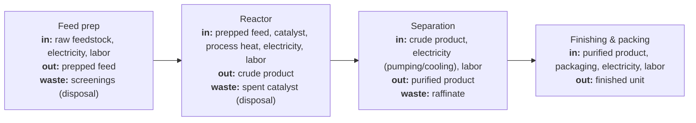

<!--
process-flow.md — written by /tea-scope, not the analyst.

This is a canonical starting document alongside scope.md, data-requirements.md,
and model-requirements.md. It is the one-glance picture of how the system
OPERATES and is approved and snapshotted together with scope-summary.md and the
canonical docs.

Author it directly from the Entity Decomposition table in scope.md: one node per
entity, edges for the flows between connected entities. Each node describes the
OPERATION of that unit — annotate it with everything that flows IN (feedstocks,
energy, consumables, labor — the operating-cost drivers), what flows OUT (the
product/intermediate handed downstream), and any WASTE stream (with disposal cost
if it carries one). Energy, labor, and consumables are shown as inputs ON the node
that consumes them — never pulled out into a separate node.

Rules:
- No data/parameter nodes. The flowchart shows physical operation, not variables.
- Do NOT add REF, BENCHMARK, or any non-process node. Benchmarks live in scope.md,
  not here. There is no "referenced vs not" distinction to draw.
- Emphasize operating-cost inputs (materials, energy, labor, consumables). CapEx is
  a property of the unit, not a flow — leave it out of the diagram.

Keep node labels in plain analyst vocabulary. It is Mermaid text — diffable and
editable, no separate image file.

Replace the example below.
-->

# Process Flow — [Display Name]

A TEA is one or more connected unit processes (entities), each with inputs, outputs,
and optionally waste streams. This diagram mirrors the **Entity Decomposition** table
in `scope.md`: every entity is a node, every "connects to" relationship is an edge.
Each node shows **how that unit operates** — what flows **in** (feedstocks, energy,
consumables, labor), what flows **out**, and any **waste stream**. Energy and other
operating inputs appear on the node that consumes them.

Notes on the flow (cut points, recycle loops, where waste leaves the boundary):

-
