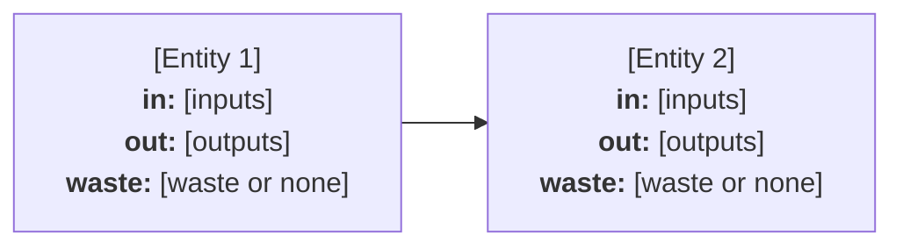

<!--
scope-summary.md - written by /tea-scope, not the analyst.

This is the human-readable "read this first" companion to the starting
documents. It is deliberately concise and non-authoritative: if it conflicts with
scope.md, process-flow.md, data-requirements.md, or model-requirements.md, those
canonical documents control. Its job is to help the user approve the setup
without having to read every pipeline artifact end to end.

Keep it short, decision-oriented, and high-leverage. Do not introduce facts,
assumptions, entities, parameters, formulas, or benchmark values that are absent
from the canonical documents. For comparison projects, summarize the shared
decision and functional unit at the project level, then list only the main
differences between options.

Replace each bracketed prompt. Delete sections that do not apply.
-->

# Scope Summary - [Display Name]

## What this TEA is deciding

[One short paragraph: the decision, comparison, or estimate this TEA supports,
and who/what the result is meant to inform.]

## The setup in one page

- **System boundary:** [in scope, out of scope, upstream/downstream cut points]
- **Functional unit:** [the denominator all headline results normalize to]
- **Basis:** [currency, base year, geography, operating basis]
- **Options or scenarios:** [single run, comparison options, or none]
- **Validation targets:** [named benchmark metrics and units only, or "none"]

## Process flow

[One short paragraph summarizing the connected entities.]

This is the same operating diagram as `process-flow.md`, included here so this
summary can be reviewed on its own.

## How the model will produce the headline number

[Condensed version of the model-requirements walkthrough: inputs feed each entity,
entity contributions are aggregated, and the result is normalized to the
functional unit. Include one short illustrative path if helpful, clearly labeled
as illustrative or user-supplied.]

## Highest-leverage things to check

Before approving, focus on these items:

- [Boundary or cut point that would materially change results]
- [Functional unit or comparison equivalence issue]
- [Assumption, fixed value, or excluded cost category worth confirming]
- [Benchmark or headline output worth adding/removing]

## What the other documents are for

The other generated documents are mostly working artifacts for the next phases of
the TEA pipeline. You can read them if you want to audit the setup, but you do
not need to read them end to end before continuing:

- `scope.md` records the full boundary, assumptions, entities, and benchmarks.
- `process-flow.md` shows the operating flow as a diagram.
- `data-requirements.md` defines the input cells that `/tea-data` will research.
- `model-requirements.md` defines the formulas and outputs that `/tea-model` will
  implement.
