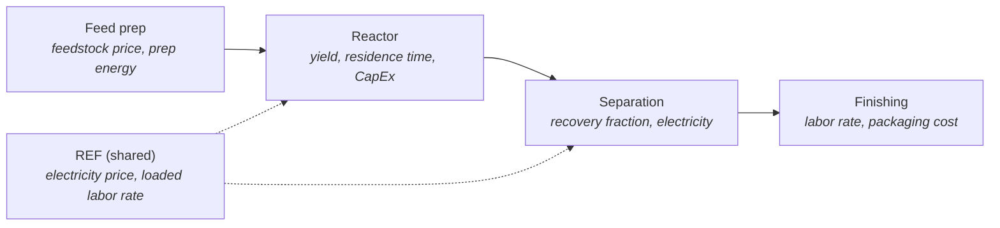

# Scope

Use this document to describe the TEA in analyst language. Stage 0 reads it
with `data-requirements.md` and compiles `tea-schema.json`. Keep prose precise;
do not worry about JSON here.

## 1. Identity

- TEA name:
- Short id:
- Analyst / owner:
- Date:
- Display vocabulary:
  - Entity label for people: process unit, cost center, activity, etc.
  - Parameter label for people: field, line item, variable, etc.

## 2. Goal And Decision Context

What decision, comparison, or estimate will this TEA support?

Answer:

## 3. System Boundary

Describe the system being analyzed.

In scope:

- 

Out of scope:

- 

Upstream cut point:

Downstream cut point:

Geography or market boundary:

Time basis or operating period:

## 4. Functional Unit

Everything should eventually be expressed per this denominator unless a
parameter explicitly uses a different basis.

- Functional unit name:
- Functional unit symbol:
- Why this is the right denominator:

Examples: `kg Ti-6Al-4V billet`, `1M tokens served`, `delivery`.

## 5. Basis Assumptions

- Base currency:
- Base year:
- Inflation index: CEPCI, CPI, PPI, or none
- Geography:
- Scale or capacity basis:
- Operating profile:
- Financial assumptions that the data pipeline should carry but not model:

## 6. Entity Decomposition

List the parts of the system that need their own data rows. These become
entities in `tea-schema.json`.

| entity id | name | output | description | connects to |
|---|---|---|---|---|
|  |  |  |  |  |

Notes on flows, dependencies, or ordering:

### Process flow

A one-glance picture of the process being modeled: one node per process unit /
entity, edges for the flows between them (mirror the `connects to` column), and the
**key data each unit needs** listed inside its node. Authored as a Mermaid
`flowchart` so it renders inline in this markdown and stays editable as text.
Replace the example below; keep node labels in plain analyst vocabulary.

## 7. Scope Frame By Entity

For each entity, define what counts as relevant evidence. Name common variants
that should be rejected so the extractor does not blend incompatible data.

### Entity: `<id>`

In scope:

Known out of scope:

- 

Ambiguous cases to hold for analyst review:

- 

Repeat for every entity.

## 8. Scenarios

One run represents one system/configuration. Use this section only for
scenario labels or assumptions that do not change the entity/parameter schema.
Run a separate TEA for a materially different system.

Scenarios:

- 

## 9. Headline Metrics

What outputs will the analyst's model calculate from the populated inputs?
The tool records this context but does not run the model.

- 

## 10. Validation Targets (benchmarks)

Optional external benchmarks the model's results will be checked against. **Name
the metric and unit only — leave the value blank.** Benchmark values are *not*
assumed at scope time; `/tea-data` researches them with citations through the same
evidence rounds as every other input, and the model surfaces them beside the
matching computed output. Each row here is compiled into a cell under the reserved
`BENCHMARK` entity (an audited cell the model ignores as an input). Fill the value
column only if the user supplies a specific cited number they want pinned.

| metric | unit | acceptable range (if user-cited) | source (if user-supplied) | value |
|---|---|---|---|---|
|  |  |  |  | _researched in data step_ |

## 11. Known Constraints And Questions

List known data gaps, likely hard-to-source areas, or choices Stage 0 should
ask about rather than infer.

- 
